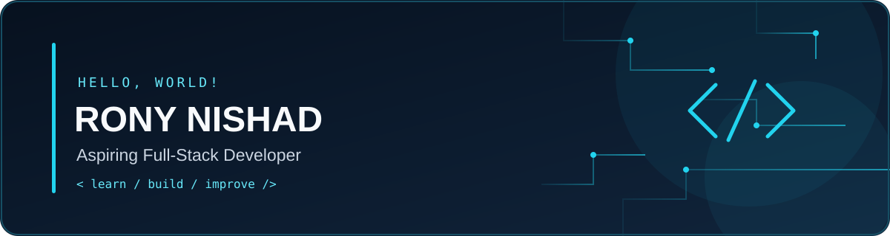

<!-- Premium Dark Navy + Cyan banner. Keep banner.svg in the root of this repository. -->

 

### `Rony Nishad` · Aspiring Full-Stack Developer

**Building useful things, learning every day.**  
**Useful projects banane aur roz kuch naya seekhne ki journey.**

  
  
  

---

## 👋 About Me | मेरे बारे में

- 🇮🇳 I'm **Rony Nishad**, an aspiring developer learning by building projects.
- 💻 Interested in **web development, mobile apps, tools, and practical software products**.
- 🌱 Currently improving my skills in **HTML, CSS, JavaScript, PHP, MySQL, Flutter, and Firebase**.
- 🧩 I enjoy exploring ideas and turning them into useful prototypes.
- 🤝 Open to learning, collaboration, and suitable freelance opportunities.

> **Hindi:** Main naye projects banakar development seekh raha hoon. Mera goal useful, accessible aur responsive web apps aur mobile apps banana hai.

> **Note:** This profile describes my learning journey. Skills and project status may change as I build and publish more work.

## 🛠️ Tech Stack | Skills I'm Learning

  
  
  
  
  
  
  
  
  
  

## 🚀 Projects & Ideas | Projects par kaam

These are project ideas / work-in-progress placeholders. Update each card with the actual repository, screenshots, and current status when ready. No completion or production-readiness is implied.

<table>
  <tr>
    <td width="50%" valign="top">
      <h3>🎙️ Tolex</h3>
      
A voice-chat app concept exploring rooms, mic seats, gifts, and wallet-style features.

      
<b>Status:</b> In development / learning — update to the accurate status.

      <a href="https://github.com/ronynishad?tab=repositories">Repository list ↗</a>
    </td>
    <td width="50%" valign="top">
      <h3>🎮 Vibe</h3>
      
A Flutter app project / prototype exploring a social-style interface and interactive features.

      
<b>Status:</b> In development / learning — update to the accurate status.

      <a href="https://github.com/ronynishad?tab=repositories">Repository list ↗</a>
    </td>
  </tr>
  <tr>
    <td width="50%" valign="top">
      <h3>🧰 Rony Tools</h3>
      
A planned collection of practical web utilities, with a focus on simple and responsive user experiences.

      
<b>Status:</b> Idea / prototype — update as work progresses.

      <a href="https://github.com/ronynishad?tab=repositories">Repository list ↗</a>
    </td>
    <td width="50%" valign="top">
      <h3>🪪 Rony PVC Card</h3>
      
A planned ordering and service website concept for PVC card-related services. Follow applicable rules and use authorized workflows.

      
<b>Status:</b> Idea / prototype — update as work progresses.

      <a href="https://github.com/ronynishad?tab=repositories">Repository list ↗</a>
    </td>
  </tr>
</table>

**Project update tip:** Once a dedicated repository is available, replace each “Repository list” link with `https://github.com/ronynishad/REPOSITORY-NAME` and add a short README, screenshots, setup instructions, and a truthful status.

## 📊 GitHub Overview

  
  

  

  

Stats are generated by third-party services and may occasionally be unavailable or delayed. Language cards reflect repository contents, not necessarily skill level.

## 🎯 Current Goals | अभी के लक्ष्य

- [ ] Build and publish clean, responsive web projects.
- [ ] Improve JavaScript, PHP, and database fundamentals.
- [ ] Keep Flutter experiments documented with screenshots and setup steps.
- [ ] Write clear READMEs and maintain projects consistently.
- [ ] Collaborate, get feedback, and keep learning.

## 🤝 Let's Connect | संपर्क करें

  
  
  

- **Email:** [bkumar16821@gmail.com](mailto:bkumar16821@gmail.com)
- **Portfolio:** [ronytech.online](http://ronytech.online/)
- **GitHub:** [@ronynishad](https://github.com/ronynishad)

---

  <i>“Learn consistently. Build honestly. Improve every day.”</i> 
  Made with curiosity by Rony Nishad · सीखते रहो, बनाते रहो ✨

